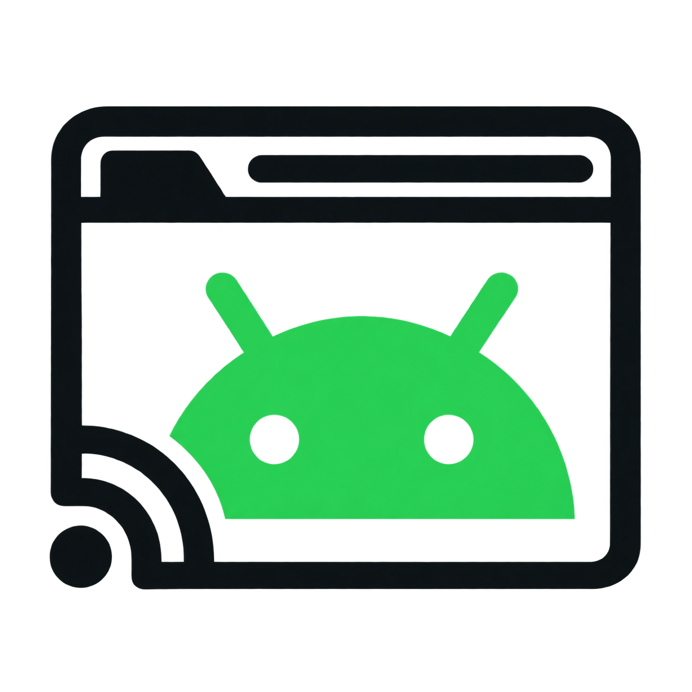

# DroidDeck

Android streamed to your browser from an Ubuntu virtual machine.



## Pilot Release

**Already running 0.1.0-rc.2 or an older signed gateway update?** The signed
**0.1.1-rc.16 updater** includes **Settings → Updates**, faster adaptive quality,
bounded live audio recovery and AAC-LC audio by default. Install the signed updater
once, then use the browser to check for pilot releases, install updates, follow
progress and request rollback. Android apps, accounts, settings and HTTPS identity
are preserved. See [update and rollback instructions](UPDATE.md) and
[pilot releases](https://github.com/chilman408/DroidDeck/releases).
See the [exact pilot acceptance record](updater/ACCEPTANCE.json).

Updates use the existing release-signing authority and original recovery engine.
The update helper runs independently of the stream, so browser disconnects do not
cancel an accepted operation. Updates require the primary display's permissions.
This is a gateway update; use the separate RC2 clean installer below for a new VM.

**Optional Automatic quality** in Settings → Display adjusts the shared encoder
to the primary display’s connection, within your selected bitrate/frame-rate
limits. It defaults off; manual choices take over immediately. See the
[quality controls](UPDATE.md#automatic-quality).

Audio format is selectable below Browser audio in Settings. The media title is
DroidDeck Audio with the DroidDeck icon. Existing private apps and secure
lockscreens are preserved.

Includes the native GPU supervision and Tesla-tested WebCodecs compatibility fixes.
Settings → Display → Renderer offers H264 (WebCodecs) and H264 (Legacy), with
legacy as the Automatic default. See [GPU guard details](docs/GPU-GUARD.md) and
[browser compatibility](docs/BROWSER-RENDERER.md).

**0.1.0-rc.2 is an early technical pilot with the reboot fix integrated.**
New installations use one source installer and one installation command. No
separate hotfix is needed. Use the RC2 clean installer below for a new VM;
the signed gateway updater above is for an existing RC2 installation.

Already running rc.1? Keep your apps and login data and use
[its dedicated hotfix](https://github.com/chilman408/DroidDeck/releases/tag/v0.1.0-rc.1-hotfix.1).
Do not run the clean installer over an existing Android setup.

## Installation

### 1. Prepare a Clean VM

Use fresh **Ubuntu 26.04.1 x86_64** on Unraid KVM with working **VirGL 3D**,
128 GiB disk, 6 GiB RAM, Internet access, and a reserved LAN IPv4 address.
Create the first regular administrative user (tested UID/GID 1000). Run the
commands inside Ubuntu, not on the Unraid host. The installer refuses populated
or partially installed targets; it does not upgrade or erase them.

### 2. Download and Verify

Download all five named assets from the
[rc.2 release](https://github.com/chilman408/DroidDeck/releases/tag/v0.1.0-rc.2)
into one directory on the VM:

- `droiddeck-0.1.0-rc.2-source.tar`
- `INSTALL.md`
- `COPYING`
- `release.json`
- `SHA256SUMS`

The TAR is the single installer package; the other files provide instructions,
licensing, acceptance metadata and checksums. Do not use GitHub's automatic
**Source code (zip)** or **Source code (tar.gz)** downloads instead.

In the download directory, verify before root extraction:

```sh
sha256sum -c SHA256SUMS
```

Continue only when every file reports `OK`. Obtain the checksums from the trusted
release channel; a checksum does not authenticate its own download source.

### 3. Install

Extract the verified source into a new root-owned directory:

```sh
sudo mkdir -m755 /usr/local/share/droiddeck-0.1.0-rc.2 &&
sudo tar --no-same-owner --no-same-permissions \
  -xf droiddeck-0.1.0-rc.2-source.tar \
  -C /usr/local/share/droiddeck-0.1.0-rc.2
```

Replace `YOUR_UBUNTU_USER` with your administrative username and `YOUR_VM_IPV4`
with the reserved private LAN address. Leave `droiddeck.invalid` unchanged:

```sh
sudo python3 -I -B \
  /usr/local/share/droiddeck-0.1.0-rc.2/droiddeck-source-candidate/droiddeck-install \
  --install-machine YOUR_UBUNTU_USER YOUR_VM_IPV4 droiddeck.invalid
```

Keep the terminal or SSH connection open until installation completes. The
installer acquires publisher-hosted inputs, compares two native/Java/library
builds, installs the complete services and verifies real Android GPU rendering.
The reboot fix and bounded startup waits are installed automatically.

If installation stops, do not rerun it or delete partial state. Preserve its
journals and follow the [recovery guidance](docs/INSTALL.md#recovery-and-scope).

### 4. Connect

Open `https://YOUR_VM_IPV4:8443/` after installation succeeds. As the selected
Ubuntu user, inspect the public TLS certificate through your authenticated VM
connection before trusting it on each client:

```sh
openssl x509 -in ~/.config/droiddeck/cert.pem -noout -sha256 -fingerprint
```

Trust only that public certificate, or use an authenticated trusted reverse
proxy. Never export `key.pem` or disable TLS verification globally. Optional
browser login defaults **off**: trusted LAN only, no Internet port forwarding.

Check video, audio after a browser gesture, touch, and reconnect after reboot.
Android should start before an interactive Ubuntu login. See the
[full guide](docs/INSTALL.md), [pilot checklist](docs/PILOT.md) and
[known limitations](docs/KNOWN_LIMITATIONS.md).

## Tested Scope

- Fresh whole-command installation with independently reproducible source TARs
  and two compared artifact builds.
- Native VirGL GPU rendering; intentional software codec4/RGBX/AAC media decoding.
- Normal reboot, reboot interrupted during Android startup, and startup taking
  longer than the original 60-second limit.
- Full-display crash recovery, desktop/mobile H264 and AAC, native touch after
  idle, and two-display handoff with continuing audio.

This is not a guarantee for every app, GPU, browser, vehicle or DRM service.
Community images, APKs, SDK tools and third-party libraries are fetched from
their publishers, not bundled or mirrored in the release.

## Defaults and Safety

Aurora Store is installed by default. Initial browser-route media volume is
100% and the initial Android lockscreen is disabled. Later user choices are
preserved. Do not replace the image's Google Play Services through Aurora.
Test vehicle browsers only while parked.

Never upload Android data, VM disks, credentials, account tokens, private keys
or DRM files. Report selected redacted errors, host/guest/browser versions and
the failing installation phase. See [SECURITY.md](SECURITY.md) for security reports.

## Source and License

`installer/` holds the exact accepted source TAR contents. Frozen build-time
candidate flags are not rewritten after testing; release `release.json` records
acceptance for those exact bytes. Old release tags/assets remain immutable.
Private development history and operational checkpoints are not published.

DroidDeck source is GPL-3.0-only; see [LICENSE](LICENSE). Upstream components keep
their own licenses. No third-party endorsement, certification or account/DRM
compatibility is asserted. This pilot is checksum-verified, not digitally signed.
